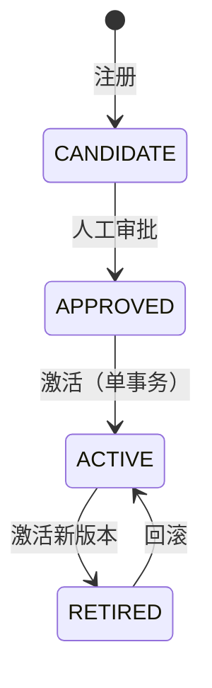

# B 卡风控链路优化作业说明（A0–A5）

> 本文把 B 卡（贷后行为评分）这一轮改造合并成一份可读文档：先讲清楚**原来有什么问题**，再讲**每个阶段怎么改、为什么这么改**，最后给出**验证结果与运行方式**。
>
> 代码位置：`F:\RiskLendPro\RiskLendPro`；公共契约在 `common-api`，风控逻辑在 `services/risk-service`，额度调整在 `services/loan-service`，离线建模在 `risk-assessment`。

---

## 一、背景：B 卡原来有哪些问题

B 卡是根据用户**贷后还款行为**（是否逾期、逾期多久、是否按时还、额度用了多少）计算的行为评分，分数会参与额度调整。原链路存在六类问题：

| # | 问题 | 后果 |
|---|---|---|
| 1 | 不可信分数也能生成额度系数 | 缺身份证/缺特征/规则缺失时返回 700 中性分，仍被当成正常分使用，可能错误降额 |
| 2 | 规则加载是永久内存缓存 | 改规则必须重启服务；`ORDER BY version DESC` 字符串排序会选错版本；可同时存在多个 active 版本 |
| 3 | 没有 as-of 概念 | 用"当前状态"回填历史快照，历史样本存在时间穿越（未来还款/未来放款/未来额度被算进过去） |
| 4 | 训练口径与线上不一致 | 离线用中位数填充、线上用 0；随机切分而非时间外验证；只用 Home Credit 静态特征 |
| 5 | 概率没有校准、阈值靠分位数 | 分数没有概率含义，阈值没有业务含义 |
| 6 | 没有发布/监控/回滚 | 换模型没有审批与回滚方案，漂移与异常无人告警 |

对应六个阶段：

```
A0 安全闸门 → A1 规则治理 → A2 as-of 快照与标签
                                  ↓
                         A3 特征工程与重训练
                                  ↓
                    A4 概率校准、阈值与影子运行
                                  ↓
                       A5 生产治理、监控与回滚
```

---

## 二、总体逻辑（一张图）

```mermaid
flowchart LR
    subgraph 数据层
        L[贷款 loan] --> S[as-of 快照<br/>BF_V2.2]
        P[还款计划] --> S
        R[还款记录] --> S
        H[额度历史<br/>user_credit_limit_history] --> S
        S --> LB[成熟标签<br/>30DPD@6M / 90DPD@12M]
    end
    subgraph 建模层
        LB --> F[特征目录<br/>28 项在线可用]
        F --> TR[时间外训练<br/>LR + 树模型]
        TR --> CAL[Platt 校准<br/>+ 业务成本阈值]
    end
    subgraph 决策层
        CAL --> SH[影子评分<br/>只写影子表]
        RULE[在线规则<br/>v1.0 / v1.1] --> GATE[可信度门禁]
        GATE --> MULT[额度系数]
    end
    subgraph 治理层
        REG[模型注册表] --> SH
        AUD[决策审计] --> MULT
        MON[监控告警] --> REG
    end
```

**一句话总结**：先把不可信分数挡在额度之外（A0），再让规则能安全发布（A1），然后用 as-of 数据训练出可信模型（A2/A3），接着让概率和阈值有业务含义（A4），最后用注册、监控、回滚把整条链路管起来（A5）。

---

## 三、各阶段做了什么

### A0 安全闸门与契约修复

**问题**：不可信分数仍能拿到额度系数；规则缺失时引擎静默返回 700 分。

**方案**

1. 额度系数接口改为 **必须带 userId**，返回决策对象 `LimitMultiplierDecision`（含 `scoreReliable / dataStatus / decisionAllowed / modelVersion / featureVersion / policyVersion / ruleHash / multiplier`）。
2. `decisionAllowed=false` 时 `multiplier` 必须为 `null`。
3. 规则缺失、JSON 解析失败、结构校验失败时，评分引擎抛 `RuleUnavailableException`，**不再返回中性 700 分**。
4. 只在 `baseScoreResolved && historyAvailable` 时设置 `scoreReliable=true`。
5. 额度调整任务只有「开关开启 + 决策放行 + 系数非空」才调额，否则保持原额度并记录跳过原因。
6. 调额日志追加等价 JSON 审计字段（模型版本、特征版本、数据状态、是否放行、规则哈希）。
7. 两个开关彻底分离：`risk.b-card.auto-adjust-enabled`（默认 false）与 `risk.overdue-level.reduce-enabled`（默认 true）。

**关键代码**：`RiskDecisionApi`、`LimitMultiplierDecision`、`InternalRiskController`、`BehaviorScoreEngineImpl`、`BehaviorScoreService`、`OverdueLimitAdjustTask`

**验证**：`BehaviorScoreServiceTest`、`BehaviorScoreEngineImplTest`、`OverdueLimitAdjustTaskTest`、`RiskDecisionApiContractTest`

---

### A1 规则治理与缓存治理

**问题**：规则永久缓存、版本排序错误、可多 active、发布没有校验。

**方案**

1. 规则缓存加 **TTL**（`risk.b-card.rule-cache-ttl-seconds`，默认 60 秒）+ **内容哈希**比对：哈希没变只续期，变了才重新解析。
2. 人工刷新接口 `POST /internal/behavior-scores/rules/refresh`。
3. 版本选择改为 `ORDER BY id DESC`（不再用 version 字符串排序）。
4. 数据库加生成列 `active_slot` + 唯一索引 `uk_bsr_single_active`，**数据库层保证至多一个 active**。
5. 发布流程：写 inactive → 结构校验 → 回放校验 → 单事务「全部下线 + 目标上线 + 校验 active 数=1」；不删除历史版本。
6. 校验面扩展：`model_type`、`card_type`、`selected_features` 与系数一致、cuts/woe 长度、阈值 `reduce<watch`、PDO 参数。
7. 移除两个退化特征（`pos_dpd_mean`、`pos_dpd_def_mean`），`inst_amt_paid_1y` 评估后保留。

**关键代码**：`BehaviorScoreEngineImpl`、`BehaviorScoringRules`、`BehaviorScoringRulesMapper`、`BehaviorRuleRefreshController`、`load_to_mysql.py`、`sql/migration_b_card_rule_governance.sql`、`sql/activate_b_card_rule.sql`

**验证**：TTL/版本切换、单 active、非法规则拒绝、退化特征回放（`BehaviorScoreEngineImplTest`、`BehaviorScoringRulesGovernanceTest`、`BehaviorScoreRuleReplayTest`）

---

### A2 As-of 特征快照与标签体系

**问题**：历史快照用当前状态回填，存在时间穿越；标签没有生成入口。

**方案**

1. 所有贷款、还款计划、还款记录、额度、逾期金额都按 `asOfDate` 过滤。
2. 贷款/计划状态**不读当前 `status`/`overdueDays`**，由 as-of 当时的还款记录推导。
3. DPD 计算时还款日不得晚于 `asOfDate`（未来还款不算历史已还）。
4. 12 个月窗口同时限制下界和上界。
5. 新增额度历史表 `user_credit_limit_history`；历史日期只读历史快照，**只有 asOfDate=今天时才允许回退实时额度**。
6. 新增标签任务：`label_30dpd_6m`（6 个月窗口）与 `label_90dpd_12m`（12 个月窗口），各自按成熟日生成。
7. 样本状态：`OPEN → MATURED → LABELED`，数据不合格为 `EXCLUDED`；创建快照时标签必须为空。
8. 特征版本升级为 `BF_V2.2`（与旧口径并存，不覆盖）。

**as-of 时间轴**

```mermaid
flowchart LR
    O[观察期<br/>asOf-180 天] --> A[asOfDate]
    A --> W6[30DPD@6M 成熟日<br/>asOf+6 月]
    A --> W12[90DPD@12M 成熟日<br/>asOf+12 月]
```

**关键代码**：`BCardFeatureServiceImpl`、`BCardLabelServiceImpl`、`BCardLabelTask`、`BCardFeatureSnapshot`、`BCardCreditLimitHistoryReader`、`CreditLimitHistoryRecorder`、`sql/migration_b_card_v2.sql`

**验证**：`BCardFeatureServiceImplTest`（时间穿越/窗口边界/额度不回退）、`BCardLabelServiceImplTest`（30+/90+ 成熟与状态流转）

---

### A3 特征工程与重新训练

**问题**：训练只用静态特征、随机切分、口径不统一。

**方案**

1. **特征目录** `output/b_card_feature_catalog.json` 作为唯一事实来源：35 项（28 项在线可用 + 7 项离线独有），统一缺失值语义（数值缺失=0，布尔=false）。
2. **时间外切分**：按 `as_of_date` 的 vintage，前 60% 训练、20% 验证、最新 OOT，禁止随机切分。
3. **四道筛选**：IV ≥ 0.02 → 单调性 |Spearman| ≥ 0.6 → 相关性 > 0.8 去共线 → PSI ≤ 0.25。
4. **双模型**：WOE+LR 可解释基线 + 树模型挑战者（按可用性选择 LightGBM/XGBoost/HistGB/GradientBoosting）。
5. 输出 AUC、KS、Lift、PR-AUC、Brier、分期坏账率、分数/特征 PSI、校准表。
6. 记录配置、数据版本、特征版本、标签版本、模型哈希，保证可重复。

**验证**：离线与在线对同一份原始数据逐字段一致（Java `BCardOfflineFeatureConsistencyTest` + Python `run_a3_checks.py`）

---

### A4 概率校准、阈值决策与影子运行

**问题**：概率没有校准含义，阈值靠分位数。

**方案**

1. 在**独立校准集**（A3 的 valid vintage）上做 **Platt 校准**，再做 PDO 映射；Isotonic 仅作诊断。
2. 阈值在概率网格上按**业务成本最小化**搜索：坏账损失 + 额度收入损失 + 客户体验成本，并约束审核容量；**不使用分位数**。
3. 影子评分：模型决策 vs 现有策略，记录差异；**只写影子表，不写额度**。
4. 输出校准曲线、分箱坏账率、Lift 表、阈值业务模拟、跨期稳定性。

**决策档位**

```
p < approve_below          → 额度系数 1.0（正常）
approve_below ≤ p < reject → 额度系数 0.5（降额）
p ≥ reject_above           → 额度系数 0.0（人工复核）
```

**关键代码**：`calibrate_b_card_model.py`、`BCardShadowScoreService`、`BCardShadowScoreTask`、`b_card_shadow_decision`

**验证**：`run_a4_checks.py`（校准/阈值回放/PSI/可重复）、`BCardShadowScoreServiceTest`（影子不写额度）

---

### A5 生产治理、监控与回滚

**方案**

1. **模型注册表** `b_card_model_registry`：版本哈希、候选/审批/激活/退役状态、单 active 唯一索引。
2. **发布审批**：CANDIDATE → APPROVED → ACTIVE；激活前校验特征版本与在线一致。
3. **回滚**：只能回滚到曾激活过的版本；单事务切换，历史版本一条不删。
4. **决策审计** `b_card_decision_audit`：每次额度决策记录模型/特征/策略/规则哈希/数据快照引用（`b_card_log:<id>`）。
5. **监控告警** `b_card_monitor_alert`：快照数、缺失率、分数 PSI、命中率、分箱坏账率、阈值漂移；`OPEN → ACKED → CLOSED` 闭环。
6. 治理接口：注册/审批/激活/回滚/告警确认/手动监控。

**模型状态机**



**关键代码**：`BCardModelRegistryService`、`BCardMonitorService`、`BCardMonitorMetrics`、`BCardGovernanceController`、`sql/migration_b_card_a5_governance.sql`

**验证**：`BCardModelRegistryServiceTest`（发布/回滚/版本一致性）、`BCardMonitorMetricsTest`（PSI/缺失率/坏账率/漂移告警）

---

## 四、关键概念用大白话解释

**as-of（时点还原）**
> 假设要还原 2026-09-01 这一天的用户状态。9 月 10 日才还的钱、9 月 20 日才放的款、9 月 5 日才改的额度，**都不能算进 9 月 1 日的快照**。代码里所有查询都加 `asOfDate` 上界，DPD 也只算到 `asOfDate`。

**可信度门禁**
> 分数可信（`scoreReliable=true`）才允许生成额度系数；否则 `decisionAllowed=false`、系数为 `null`，调额任务直接跳过。宁可不动额度，也不能用错分数动额度。

**WOE**
> 把原始特征按分箱映射成"好坏比的对数"，让线性模型能处理非线性关系。WOE 和系数都从训练集拟合，线上只做查表。

**Platt 校准**
> 模型输出的原始概率常常偏大或偏小；用一个一维逻辑回归 `p=sigmoid(a·logit+b)` 把它拉回到真实坏账率。

**业务成本阈值**
> 不是"取 70% 分位"这种拍脑袋做法，而是把「坏账损失、降额导致的收入损失、客户体验成本、审核容量」都折算成钱，选总成本最低的阈值。

**影子运行**
> 新模型只"偷偷打分"并记录，不真的改额度；拿它的决策和现有策略对比，确认更好后再申请上线。

---

## 五、数据库变更一览

| 表 | 变更 | 说明 |
|---|---|---|
| `behavior_scoring_rules` | `rule_content` 改 LONGTEXT；加治理列；加单 active 唯一索引 | A1 |
| `b_card_feature_snapshot` | 加 7 列（成熟日/标签版本/计算时间/质量/哈希/来源）+ 索引 | A2 |
| `user_credit_limit_history` | 新建 | A2 |
| `b_card_shadow_decision` | 新建 | A4（服务启动时自动建） |
| `b_card_model_registry` | 新建 | A5 |
| `b_card_decision_audit` | 新建 | A5 |
| `b_card_monitor_alert` | 新建 | A5 |

迁移脚本：`sql/migration_b_card_rule_governance.sql`、`sql/migration_b_card_v2.sql`、`sql/migration_b_card_a5_governance.sql`（均可重复执行）。

---

## 六、测试与验证结果

### Java 单元测试

```bash
mvnw -pl services/risk-service,services/loan-service -am test
```

| 模块 | 用例数 | 结果 |
|---|---:|---|
| risk-service | 70 | 全部通过 |
| loan-service | 19 | 全部通过 |
| **合计** | **89** | **0 失败** |

### Python 离线链路

```bash
cd risk-assessment
python tests/run_a3_checks.py   # 6/6
python tests/run_a4_checks.py   # 5/5
```

| 检查 | 结果 |
|---|---|
| 离线/在线特征一致（28 特征 × 3 用例） | 通过 |
| OOT 训练可重复（两次模型哈希一致） | 通过 |
| 退化/噪声/共线特征不入模 | 通过 |
| 指标/PSI/校准输出完整 | 通过 |
| 概率校准与阈值回放 | 通过 |
| 影子产物只读约束 | 通过 |

### 已在实际数据库验证

- A1/A2/A5 迁移执行成功，数据未被改写；
- 规则加载：`v1.0-b-woe`，`activeVersionCount=1`，`thresholdSource=DB_COLUMN`；
- 首日冒烟：生成 14 条 `BF_V2.2` 快照，`feature_hash` 非空、标签为空、`sample_status=OPEN`。

---

## 七、代码结构（新增部分）

```
common-api/
  api/contract/RiskDecisionApi.java           # 额度系数必须带 userId
  api/dto/LimitMultiplierDecision.java        # 决策对象

services/risk-service/.../risk/
  score/BehaviorScoreEngineImpl.java          # 规则 TTL/哈希/校验/失败关闭
  score/BehaviorScoreService.java             # 可信度门禁 + 审计
  score/BehaviorRuleRefreshController.java    # 人工刷新
  client/InternalRiskController.java          # 用户维度决策接口
  bcard/BCardFeatureServiceImpl.java          # as-of 特征
  bcard/BCardLabelServiceImpl.java            # 成熟标签
  bcard/BCardShadowScoreService.java          # 影子评分（只读）
  bcard/BCardModelRegistryService.java        # 发布/回滚
  bcard/BCardMonitorService.java              # 监控告警
  admin/BCardGovernanceController.java        # 治理接口

services/loan-service/.../loan/
  repay/OverdueLimitAdjustTask.java           # 额度调整门禁 + 审计
  history/CreditLimitHistoryRecorder.java     # 额度历史

risk-assessment/
  build_asof_features.py                      # 离线 as-of 特征
  train_b_card_model.py                       # 时间外训练
  calibrate_b_card_model.py                   # 校准/阈值/影子回放
  woe_binning.py                              # 四道筛选
  tests/run_a3_checks.py / run_a4_checks.py   # 验证运行器

sql/                                          # 幂等迁移脚本
docs/                                         # 阶段报告 + 本文
```

---

## 八、局限说明（作业视角）

1. 训练/校准/影子回放使用**合成 fixture** 数据（`deployable=false`），用于证明逻辑；真实效果需要等真实快照与成熟标签。
2. 真实影子验收、PSI/坏账率告警校准需要线上数据积累，本作业只验证规则与流程。
3. 告警阈值（LGD、收入损失、体验成本、审核容量）是示例值，可配置。
4. 3/6 个月窗口特征已在目录中定义但标记为离线独有，需扩展在线特征向量后才能入模。
5. 自动调额始终默认关闭；治理接口需要管理员 JWT。

---

## 九、三步演示

```bash
# 1. 全部 Java 测试（89 项）
cd F:\RiskLendPro\RiskLendPro
mvnw -pl services/risk-service,services/loan-service -am test

# 2. 离线特征/训练/OOT（6/6）
cd risk-assessment && python tests/run_a3_checks.py

# 3. 校准/阈值/影子（5/5）
python tests/run_a4_checks.py
```

预期：`BUILD SUCCESS`、`6/6 通过`、`5/5 通过`。