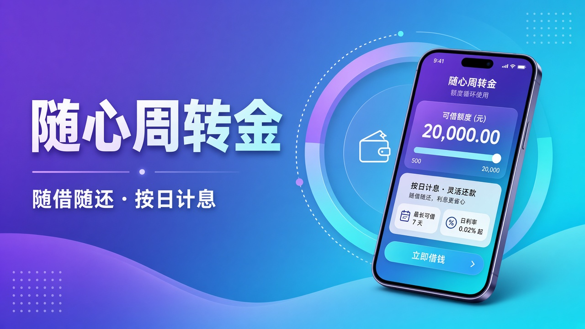

# 演示产品目录（知识库种子）

给用户端列表、管理端目录、以及智能客服知识库用的一套演示数据。  
机构名、产品名都是虚构的，要素参考 2025 年前后互联网信用贷、银行公积金贷、小微信贷、房抵/车抵、消费分期的常见公示口径，**不是真实持牌产品**。

本页里的封面是本地预览，方便看文档。App 列表/详情里的照片 **只从腾讯云 COS 读**：表里存 `object_key`，接口用 `CosStorageService.accessUrl` 签出 GET 地址。

配套文件：

| 文件 | 用途 |
|---|---|
| 本页 | 产品文案、封面预览、给同学做 RAG 的可读知识 |
| `images/` | 上传 COS 用的源文件（4 张 Logo + 12 张封面） |
| `sync_to_cos.py` | 把源文件 PUT 到 COS，可选顺带执行 SQL |
| `sql/seed_loan_catalog_demo.sql` | 写入机构 / 产品 / 标签 / `loan_image.object_key` |

导入 SQL 后，管理端 `GET /api/v1/admin/products/knowledge/export` 就能导出 12 块知识文本。草稿不会进知识库，所以种子全部标成「曾经上过架」；其中 1 条是已下架，用来测助手对下架产品的回答。

---

## 怎么对齐真实平台

| 本目录产品 | 形态参考 | 刻意不同的地方 |
|---|---|---|
| 薪金闪贷 | 互联网银行小额信用贷（微粒贷一类） | 不用真实品牌；额度 1 千–20 万、年化 7.2%–18.25% |
| 随心周转金 | 大厂钱包循环额度（借呗/信用贷一类） | 随借随还 + 按日计息话术；年化 5.5%–21.9% |
| 公积金专享贷 | 银行公积金信用贷 | 利率明显更低；口径标成「仅利息」 |
| 公职优待贷 | 银行公职/事业单位专享 | 客群收窄，利率下限 3.45% |
| 经营周转贷 | 小微信用经营贷 | 成立满 1 年、流水覆盖；不做 2.3% 那种房抵经营贷价格 |
| 个体商户快贷 | 个体户快贷 | 额度更小、利率更高 |
| 安居房抵贷 | 银行住房抵押消费贷 | 抵押率 70%，期限最长 10 年 |
| 途安车抵贷 | 汽车金融车抵 | 车龄、评估费单独写 |
| 安心家装分期 | 装修场景分期 | 款项直付合作商户 |
| 学途教育分期 / 智选数码分期 | 学费、3C 分期 | 场景字段分开，方便助手按用途检索 |
| 暑期消费专项 | 活动型产品 | **已下架**，知识库只保留下架说明 |

利率都落在监管常见上限 24% 以内。站内能借的产品一律按月、且含等额本息/等额本金/先息后本之一（`inPlatformApply`）。

---

## 机构

### 星河银行 `BANK`


全国性股份制银行演示品牌。表内信用贷、公积金贷、房抵贷都走这家，用来和消金、小贷形成利率差。

### 蓝海消费金融 `CONSUMER_FINANCE`


持牌消金演示品牌。循环额度、装修/教育/数码分期走这家。

### 青梧小贷 `MICRO_LOAN`


区域小贷演示品牌。只做经营用途信用贷。

### 途安汽车金融 `AUTO_FINANCE`


汽车金融演示品牌。只做车辆抵押。

---

## 产品总览

| 产品 | 分类 | 机构 | 额度 | 期限 | 参考年化 | 站内可借 | 状态 |
|---|---|---|---|---|---|---|---|
| 薪金闪贷 | 个人信用贷 | 星河银行 | 1,000–200,000 | 3–24 个月 | 7.20%–18.25% | 是 | 上架 |
| 随心周转金 | 个人信用贷 | 蓝海消费金融 | 500–200,000 | 1–12 个月 | 5.50%–21.90% | 是 | 上架 |
| 公积金专享贷 | 个人信用贷 | 星河银行 | 10,000–500,000 | 6–60 个月 | 3.85%–8.80% | 是 | 上架 |
| 公职优待贷 | 个人信用贷 | 星河银行 | 20,000–800,000 | 12–60 个月 | 3.45%–6.90% | 是 | 上架 |
| 经营周转贷 | 企业经营贷 | 青梧小贷 | 10,000–1,000,000 | 3–36 个月 | 5.80%–12.80% | 是 | 上架 |
| 个体商户快贷 | 企业经营贷 | 青梧小贷 | 5,000–300,000 | 3–24 个月 | 8.80%–16.80% | 是 | 上架 |
| 安居房抵贷 | 抵押贷款 | 星河银行 | 100,000–5,000,000 | 12–120 个月 | 3.85%–6.80% | 是 | 上架 |
| 途安车抵贷 | 抵押贷款 | 途安汽车金融 | 10,000–500,000 | 6–36 个月 | 7.80%–15.60% | 是 | 上架 |
| 安心家装分期 | 消费分期 | 蓝海消费金融 | 5,000–300,000 | 6–36 个月 | 6.90%–15.80% | 是 | 上架 |
| 学途教育分期 | 消费分期 | 蓝海消费金融 | 3,000–150,000 | 6–24 个月 | 5.90%–12.80% | 是 | 上架 |
| 智选数码分期 | 消费分期 | 蓝海消费金融 | 500–30,000 | 3–24 个月 | 7.20%–18.00% | 是 | 上架 |
| 暑期消费专项 | 消费分期 | 蓝海消费金融 | 1,000–20,000 | 3–12 个月 | 9.90%–18.00% | 否 | 已下架 |

核实日期统一 `2026-10-08`。信息来源统一写成对应机构「官方 App 产品页（演示整理）」。

---

## 1. 薪金闪贷


- **机构 / 分类 / 标签**：星河银行 · 个人信用贷 · 工薪族、无抵押
- **简介**：面向有稳定工资流水的工薪族，纯信用、无抵押。小额起步、线上审批，适合发薪日前的短期缺口。
- **额度 / 期限**：1,000 至 200,000 元；3 至 24 个月
- **利率**：7.20% 至 18.25%；单利；已包含利息及相关费用
- **还款**：等额本息、先息后本；支持提前结清，按实际占用天数计息，不收违约金
- **放款**：最快当日到账
- **人群**：工薪族；22–55 岁；月收入不低于 4,000 元或近 6 个月工资流水可核验
- **征信 / 职业**：近 2 年无连三累六，当前无严重逾期；企事业单位或连续缴纳社保的劳动合同员工
- **地区 / 抵押**：全国；无需抵押
- **材料**：身份证、借记卡、近 6 个月工资流水
- **其他费用**：机构明示无其他费用
- **备注**：演示产品。实际利率按个人资质定价，最终以审批和合同为准。

---

## 2. 随心周转金



- **机构 / 分类 / 标签**：蓝海消费金融 · 个人信用贷 · 工薪族、随借随还、无抵押
- **简介**：循环额度信用贷。额度内可反复支用，按日计息，适合几天到一两个月的周转，不适合长期大额经营用途。
- **额度 / 期限**：500 至 200,000 元；1 至 12 个月
- **利率**：5.50% 至 21.90%；单利；已包含利息及相关费用
- **还款**：随借随还、先息后本、等额本息；随时还款，利息计至还款日前一天
- **放款**：审批通过后即时到账
- **人群**：工薪族；22–55 岁；有稳定收入来源即可申请
- **征信 / 职业**：近 6 个月逾期不超过 1 次；职业不限但需可联系
- **地区 / 抵押**：全国；无需抵押
- **材料**：身份证、本人银行卡
- **其他费用**：机构明示无其他费用
- **备注**：演示产品。循环额度可能随使用情况和征信变化调升或调降。

---

## 3. 公积金专享贷


- **机构 / 分类 / 标签**：星河银行 · 个人信用贷 · 公积金、无抵押
- **简介**：连续缴存住房公积金的在职人员专享。银行表内信用贷，利率低于普通消金产品，审核看缴存连续性和账户状态。
- **额度 / 期限**：10,000 至 500,000 元；6 至 60 个月
- **利率**：3.85% 至 8.80%；单利；仅为利息部分（是否另有费用见「其他费用」）
- **还款**：等额本息、等额本金；贷款期满 6 个月后可提前结清
- **放款**：审批通过后 1–3 个工作日
- **人群**：公积金缴存人群；23–55 岁；连续缴存满 6 个月且账户正常
- **征信 / 职业**：征信良好、无当前逾期；缴存单位在职
- **地区 / 抵押**：全国；无需抵押
- **材料**：身份证、公积金缴存证明、收入证明
- **其他费用**：有。部分地区可能按当地政策收取担保或保险费用，以合同为准
- **备注**：演示产品。缴存中断、提取后余额过低可能影响额度。

---

## 4. 公职优待贷


- **机构 / 分类 / 标签**：星河银行 · 个人信用贷 · 社保、无抵押
- **简介**：公务员、事业单位在编及国有企业正式员工专享。客群稳定，利率下限接近银行优质零售定价。
- **额度 / 期限**：20,000 至 800,000 元；12 至 60 个月
- **利率**：3.45% 至 6.90%；单利；已包含利息及相关费用
- **还款**：等额本息、等额本金；允许部分提前还款，无违约金
- **放款**：审批通过后 1–2 个工作日
- **人群**：公职人员；22–58 岁；财政统发或单位代发工资
- **征信 / 职业**：近 5 年无贷款核销和严重逾期；公务员、事业单位在编或国企正式员工
- **地区 / 抵押**：全国；无需抵押
- **材料**：身份证、工作证或在职证明、近 6 个月工资流水
- **其他费用**：机构明示无其他费用
- **备注**：演示产品。劳务派遣、临聘人员不适用本产品。

---

## 5. 经营周转贷


- **机构 / 分类 / 标签**：青梧小贷 · 企业经营贷 · 小微企业、企业主、无抵押
- **简介**：给小微企业主做进货、发工资、淡旺季周转。纯信用，不强制抵押。资金不得用于购房、理财和股本权益投资。
- **额度 / 期限**：10,000 至 1,000,000 元；3 至 36 个月
- **利率**：5.80% 至 12.80%；单利；已包含利息及相关费用
- **还款**：等额本息、先息后本；到期日前可申请无还本续贷，以机构审批为准
- **放款**：资料齐后 1–3 个工作日
- **人群**：小微企业主、个体工商户；22–60 岁
- **收入 / 征信 / 职业**：近 12 个月经营流水可覆盖拟借本息；企业及企业主无当前逾期，近 24 个月无连三累六；法定代表人或持股 10% 以上且持股满 1 年的股东
- **抵押**：可选
- **补充条件**：企业成立年限下限 1 年；经营时间下限 12 个月；近一年营业收入原则上不低于 50 万元；需提供在营状态的营业执照
- **材料**：身份证、营业执照、近 12 个月对公或个人经营流水
- **其他费用**：机构明示无其他费用
- **备注**：演示产品。空壳公司、无真实经营痕迹无法通过。

---

## 6. 个体商户快贷


- **机构 / 分类 / 标签**：青梧小贷 · 企业经营贷 · 个体工商户、无抵押
- **简介**：个体工商户小额快贷。门槛低于企业主产品，额度更小、利率更高，适合档口、餐饮、便利店的进货周转。
- **额度 / 期限**：5,000 至 300,000 元；3 至 24 个月
- **利率**：8.80% 至 16.80%；单利；已包含利息及相关费用
- **还款**：等额本息、随借随还
- **放款**：工作日 24 小时内
- **人群**：个体工商户；22–55 岁；近 6 个月经营收款可核验
- **征信 / 职业**：当前无逾期；持有有效个体工商户营业执照的经营者
- **抵押**：无需抵押
- **补充条件**：成立年限下限 1 年；经营时间下限 6 个月；近 6 个月经营收款可核验；个体工商户营业执照在有效期内
- **材料**：身份证、营业执照、收款码或对账单
- **其他费用**：机构明示无其他费用
- **备注**：演示产品。注册地与实际经营地长期不一致可能被拒。

---

## 7. 安居房抵贷


- **机构 / 分类 / 标签**：星河银行 · 抵押贷款 · 房产抵押
- **简介**：用本人或配偶名下住宅做抵押，额度高、年限长、年化接近住房相关零售定价。资金用途按消费或经营在合同中约定，不得违规流入房地产和股市。
- **额度 / 期限**：100,000 至 5,000,000 元；12 至 120 个月
- **利率**：3.85% 至 6.80%；单利；仅为利息部分
- **还款**：等额本息、等额本金；可提前结清，按已计利息收取至结清日
- **放款**：完成抵押登记后 1–5 个工作日
- **人群**：有房人群；22–60 岁；有稳定收入证明月供覆盖能力
- **征信 / 职业**：无当前逾期，近 24 个月贷款逾期不超过 2 次；不限职业，需能提供收入或经营材料
- **抵押**：需要抵押
- **补充条件**：可接受抵押物为房产；住宅或公寓，房龄原则上不超过 30 年、产权清晰可办理抵押；抵押率上限 70%
- **材料**：身份证、房产证、婚姻状况证明、收入证明
- **其他费用**：有。房产评估费、抵押登记费由借款人承担，以当地不动产中心及评估机构报价为准
- **备注**：演示产品。共有产权、未结清按揭需征得共有人或按揭行同意。

---

## 8. 途安车抵贷


- **机构 / 分类 / 标签**：途安汽车金融 · 抵押贷款 · 车辆抵押
- **简介**：本人名下非营运小客车抵押，评估后放款。适合有车、短期需要一笔周转金但不想动房产的人。
- **额度 / 期限**：10,000 至 500,000 元；6 至 36 个月
- **利率**：7.80% 至 15.60%；单利；仅为利息部分
- **还款**：等额本息；允许提前结清，可能收取不超过剩余本金 1% 的手续费，以合同为准
- **放款**：车辆评估并办理抵押后 1–2 个工作日
- **人群**：有车人群；22–55 岁
- **征信 / 职业**：当前无逾期；不限职业
- **抵押**：需要抵押
- **补充条件**：可接受抵押物为车辆；本人名下非营运小型汽车，车龄一般不超过 8 年；抵押率上限 80%
- **材料**：身份证、行驶证、车辆登记证
- **其他费用**：有。车辆评估及抵押登记相关费用在放款前一次性收取或从额度中扣减
- **备注**：演示产品。营运车辆、抵押状态车辆、大事故车不收。

---

## 9. 安心家装分期


- **机构 / 分类 / 标签**：蓝海消费金融 · 消费分期 · 装修
- **简介**：装修场景分期。审批后款项直接付给合作装修公司或建材商户，不现金支用，降低挪用风险。
- **额度 / 期限**：5,000 至 300,000 元；6 至 36 个月
- **利率**：6.90% 至 15.80%；复利（内部收益率法）；已包含利息及相关费用
- **还款**：等额本息；装修验收前可申请提前结清
- **放款**：商户确认开工或材料订单后分期划付
- **人群**：有房人群；22–55 岁；有装修合同或报价单
- **征信 / 职业**：近 12 个月逾期不超过 1 次；不限职业
- **抵押**：无需抵押
- **补充条件**：适用场景为装修；合作商户范围为平台合作装修公司及建材商户；款项直接支付给商户
- **材料**：身份证、装修合同、房产证明或租赁合同
- **其他费用**：机构明示无其他费用
- **备注**：演示产品。现金提现、支付给非合作商户不在本产品范围内。

---

## 10. 学途教育分期


- **机构 / 分类 / 标签**：蓝海消费金融 · 消费分期 · 教育
- **简介**：学历提升、职业培训学费分期。按学期或按培训周期还款，学费付给合作机构。
- **额度 / 期限**：3,000 至 150,000 元；6 至 24 个月
- **利率**：5.90% 至 12.80%；复利（内部收益率法）；已包含利息及相关费用
- **还款**：等额本息；退学退费按培训机构规则处理，已产生利息不退
- **放款**：机构确认入学或开课日后划付
- **人群**：不限（机构明示）；18–45 岁
- **征信 / 职业**：无当前逾期；在校或在职均可
- **抵押**：无需抵押
- **补充条件**：适用场景为教育；合作培训及学历提升机构；款项直接支付给商户
- **材料**：身份证、录取通知或培训合同
- **其他费用**：机构明示无其他费用
- **备注**：演示产品。兴趣类短期体验课可能不在合作范围内。

---

## 11. 智选数码分期


- **机构 / 分类 / 标签**：蓝海消费金融 · 消费分期 · 数码、购物
- **简介**：手机、电脑、数码配件购物分期。适合不想一次性付清 3C 的用户，额度小、期限短。
- **额度 / 期限**：500 至 30,000 元；3 至 24 个月
- **利率**：7.20% 至 18.00%；复利（内部收益率法）；已包含利息及相关费用
- **还款**：等额本息；收货 7 日内按商户规则退货后可撤销未入账分期
- **放款**：下单支付时以分期额度结算给商户
- **人群**：不限（机构明示）；18–50 岁
- **征信 / 职业**：近 6 个月无当前逾期；不限职业
- **抵押**：无需抵押
- **补充条件**：适用场景为数码、购物；合作数码卖场及线上旗舰店；款项直接支付给商户
- **材料**：身份证
- **其他费用**：机构明示无其他费用
- **备注**：演示产品。黄金、投资收藏类商品不可用本分期。

---

## 12. 暑期消费专项（已下架）


- **机构 / 分类 / 标签**：蓝海消费金融 · 消费分期 · 购物
- **状态**：已下架（下架时间 2026-09-01）
- **简介**：暑期购物活动额度，活动结束后下架。知识库导出应走下架模板：不再展示额度、利率、费用和申请条件，引导咨询机构官方渠道。
- **下架前要素（仅管理端可见）**：1,000–20,000 元；3–12 个月；9.90%–18.00%
- **备注**：留给助手测「这个产品还能申请吗」——正确答案是不能，去问蓝海消费金融官方渠道。

---

## 给 AI 助手的边界

1. 只根据本目录和导出接口回答产品问题，不要编造额度或「一定能批」。
2. 知识库文案里的申请方式仍是「请走机构官方渠道」；站内能不能借看接口字段 `inPlatformApply`。本套上架产品（除已下架那条）按月且含标准还款方式，用户端会显示可申请。
3. 「暂无数据」表示平台没录入，不代表机构没有该限制。
4. 「为何被拒」不要用产品知识去编风控原因，走固定话术。
5. 风险提示统一：贷款有风险，借款需谨慎，请根据自身还款能力合理借款。

---

## 如何入库

图片必须先上 COS。库表 `loan_image.object_key` 只存对象键，例如 `loan/cover/seed/cover-salary-flash.jpg`。用户端/管理端详情里的 `coverImage.url` 由 `CosStorageService.accessUrl` 签发（私有桶是带时效的 GET 签名），**不会读本地 `images/`**。

在仓库根目录执行：

```bat
python docs/seed-catalog/sync_to_cos.py --with-sql
```

脚本会：

1. 读取 `config/local/application-local.yml` 里的 COS 配置（不要把密钥提交进 git）
2. 把 `images/` 上传到桶内固定前缀 `loan/cover/seed/`、`loan/institution_logo/seed/`
3. HEAD 校验远端文件大小
4. `--with-sql` 时执行 `sql/seed_loan_catalog_demo.sql`，写入机构、产品、标签和图片登记

然后：

1. 用管理员账号打开产品列表，确认 11 条上架、1 条下架。
2. 点开详情，封面 URL 应是 `*.myqcloud.com/loan/cover/seed/...` 的签名地址，匿名直链在私有桶上会 403，用接口返回的签名链接应是 200。
3. 调用 `GET /api/v1/admin/products/knowledge/export`，把返回的 `content` 交给同学做知识库。知识库文本不包含图片。
